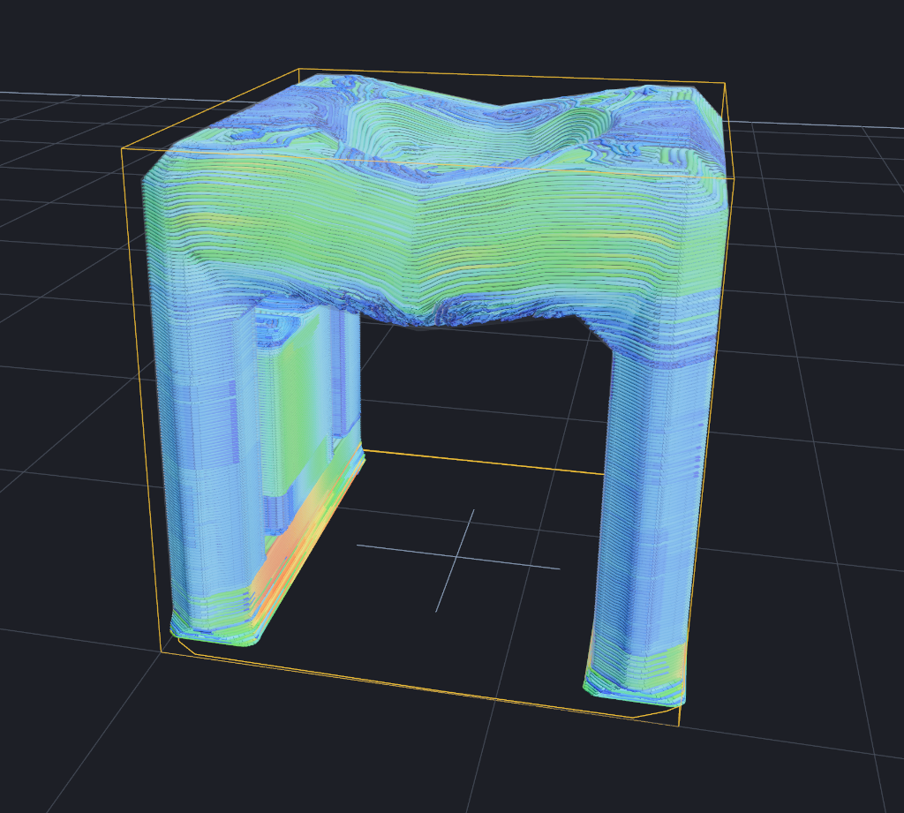

# Manifold Slicer

**Manifold Slicer** (`Manifold2`) is a volumetric, non-planar, multi-axis additive manufacturing slicer built on a hybrid **C++20 (OpenCASCADE + OpenVDB)** geometry/field kernel and a **Rust (Bevy + egui)** interactive 3D frontend, toolpath engine, and Klipper G-code compiler.



Unlike conventional 2.5D planar slicers that intersect triangle meshes with flat horizontal $Z$ planes, Manifold Slicer represents parts as volumetric scalar and vector fields in **bed coordinates**, solves a constrained anisotropic Eikonal PDE for collision-free arrival-time manifolds $\tau(\mathbf{x})$, and generates true 3D conformal toolpaths with physics-based non-Newtonian polymer rheology compensation.

---

## Key Features

### Multi-Axis Kinematics & Hardware Independence
- **Arbitrary 3D Nozzle Orientation & Bed-Coordinate Gravity**: Never assumes the nozzle axis is $+Z$ or that gravity is $-Z$. Every field, overhang check, clearance cone, and toolpath move queries the local right-handed orthonormal **`NozzleFrame`** $(\hat{\mathbf{x}}_{\text{nozzle}}, \hat{\mathbf{y}}_{\text{nozzle}}, \hat{\mathbf{z}}_{\text{nozzle}})$ and the true bed-coordinate gravity vector $\hat{\mathbf{g}}_{\text{bed}}$.
- **6-Axis Robot Arms, 5-Axis Tilting Beds & 3-Axis Gantries**: Supports 6-axis robotic extrusion cells, 5-axis tilting build plates (`Rx`, `Ry`), and non-planar conformal slicing within the physical toolhead clearance cone of 3-axis CoreXY, Cartesian, and Delta printers.
- **Multi-Tool Registry & Revolved XZ Clearance Envelopes**: Configure multiple extrusion toolheads (`T0`, `T1`, …), each with its own orifice diameter, temperature, rotational tilt limit, and piecewise-linear XZ clearance profile (`clearance_profile_xz`).

### Native CAD Ingestion & Multi-Plate `.3mf` Projects
- **Direct STEP B-Rep CAD Import (`.step` / `.stp`)**: Powered by **OpenCASCADE (OCCT)**, preserving exact topological `TopoDS_Face` patches so you can click individual CAD faces to assign conformal or orthogonal layer orientation hints.
- **Mesh Import (`.stl` / `.3mf`)**: Automatic coplanar surface-patch segmentation, 3D Quickhull **Place on Face** orientation, and Archimedean spiral collision-free auto-arrangement.
- **Multi-Plate `.3mf` Ecosystem**: Native multi-plate workspace compatible with `.3mf` projects from **Manifold Slicer**, **OrcaSlicer**, **Bambu Studio**, and **PrusaSlicer**.

### Volumetric OpenVDB Dual-Grid & Constrained Eikonal Slicing
- **Dual-Grid Multi-Resolution**: Solves global arrival-time propagation on a coarse interior core grid ($\Delta x_{\text{coarse}} = R \cdot \Delta x_{\text{fine}}$, $64\times$ fewer interior voxels at $R = 4$) while refining the outer shell ($-T_{\text{shell}} \le \phi_{\text{sdf}} \le 0$) on a fine narrow-band grid ($\Delta x_{\text{fine}}$) with conformal mesh subdivision.
- **Automatic Overhang Conformal vs. Orthogonal Surface Bias**: Smoothly steers boundary layers between **orthogonal** ($\nabla\tau \perp \hat{\mathbf{n}}_{\text{surf}}$) on walls and moderate overhangs (so layers tilt to support overhangs at $90^\circ$) and **conformal** ($\nabla\tau \parallel \pm\hat{\mathbf{n}}_{\text{surf}}$) on shallow domes/roofs (eliminating stair-stepping) and steep ceilings.
- **Interactive Surface & 3D Point Orientation Hints**: Click B-Rep faces or mesh patches to request **Conformal (`Normal ⊥ Surface`)** or **Orthogonal (`Normal ∥ Surface`)** layers, or place **3D Point Hints** with Wendland $C^2$ radial falloff.
- **Reeb-Graph Multi-Branch Layer Scheduling**: Bidirectional variable layer height scheduling (`target_mm`, `min_mm`, `max_mm`, `first_layer_mm`, `top_layer_mm`) across branching topologies and local maxima.

### 3D Conformal Shells, Arachne Variable Widths & TPMS Infill
- **True 3D Euclidean Shell Thickness**: Enforces a uniform 3D signed-distance skin ($-T_{\text{shell}} \le \phi_{\text{sdf}}(\mathbf{x}) \le 0$) across roofs, floors, domes, and walls alike.
- **Arachne-Style Medial-Axis Variable Bead Sizing**: Dynamically adapts perimeter and infill widths within `[min_mm, target_mm, max_mm]` and extracts medial-axis `GapFill` beads in narrow wedges.
- **Volumetric 3D TPMS Lattices**: Intersects curved non-planar layers directly with analytical 3D **Gyroid**, **Schwarz-D (Diamond)**, **Schwarz-P (Primitive)**, and **Cubic** space-diagonal lattices.
- **Circular Bridging, Inside-Out Wave Overhangs & Causal Supports**: Distinguishes two-pier straight bridges (`Bridge`) from one-sided cantilevers printed via inside-out `WaveOverhang` passes with controlled lateral overlap, and projects gravity-aligned `Support` / `SupportInterface` columns that can causally seed the Eikonal order field.

### Non-Newtonian Polymer Rheology & Klipper G-code Compiler
- **Chained Lookahead Planner with Stepper Back-EMF Roll-Off**: Plans entry, cruise, and exit speeds across 3D polylines using Klipper's `square_corner_velocity`, `minimum_cruise_ratio`, volumetric flow cap $Q_{\max}$, and high-speed stepper torque decay.
- **Shear-Thinning Pressure Advance & Viscoelastic Die Swell**: Power-law interpolation of $k(Q)$ and die swell $B(Q)$ between calibrated low- and high-flow anchor points, with outer-wall die-swell insetting, corner overlap deduction, first-order melt-chamber transient pressure lag, flat-nozzle slope clearance, and 3D helical scarf joints.
- **Klipper & Moonraker Integration**: Emits convex-hull `EXCLUDE_OBJECT_DEFINE` polygons and embeds `32x32` and `300x300` isometric 3D toolpath PNG thumbnails in the `.gcode` header.

---

## Building from Source

### Prerequisites
- **Rust** (stable toolchain, 2021 edition)
- **C++20 compiler** (`clang++` or `g++`) and **CMake** ($\ge 3.20$)
- **OpenCASCADE Technology (OCCT)** ($\ge 7.7$)
- **OpenVDB** ($\ge 10.0$) and **Intel TBB** (`onetbb`)

On **macOS (Homebrew)**:
```bash
brew install opencascade openvdb tbb cmake
```

On **Ubuntu / Debian**:
```bash
sudo apt-get install libocct-data-exchange-dev libocct-foundation-dev \
  libocct-modeling-algorithms-dev libocct-modeling-data-dev \
  libopenvdb-dev libtbb-dev cmake build-essential
```

### Compile & Run
```bash
# Build and launch the interactive 3D GUI in release mode
cargo run --release --package manifold-frontend
```

---

## Command-Line Interface (CLI) Quick Start

The `manifold-frontend` binary operates as both an interactive 3D desktop application and a headless CLI for batch slicing and profile management:

```bash
# Launch the interactive 3D GUI (optionally preloading a profile and 3D files)
manifold-frontend
manifold-frontend gui -p my_profile.json part.step

# Headless slice a STEP/STL/3MF part to G-code using presets and parameter overrides
manifold-frontend slice \
  --printer "256³ CoreXY (Standard Klipper)" \
  --filament "Generic PETG" \
  --process "0.20mm Standard Non-Planar" \
  -s slicing.infill_density_percent=30 \
  -s slicing.sparse_infill_pattern=Gyroid \
  part.step -o part.gcode

# Slice a multi-plate .3mf project (exports one .gcode file per populated plate)
manifold-frontend slice project.3mf -o ./gcode_out/

# Initialize, inspect, modify, and diff JSON or TOML profiles
manifold-frontend profile init my_profile.json --filament "Generic ASA (Enclosed)"
manifold-frontend profile set my_profile.json layer_height.target_mm=0.16 enable_scarf_joint=true
manifold-frontend profile diff my_profile.json
manifold-frontend profile keys --filter overhang

# Generate rheology calibration G-code patterns (Extrusion Multiplier, Ellis PA, Transient Melt Pressure)
manifold-frontend calibrate em -p my_profile.json -t T0 --pass 1 -o calib_em_pass1.gcode
manifold-frontend calibrate pa -p my_profile.json -t T0 --mode dual -o calib_pa_dual.gcode
manifold-frontend calibrate transient -p my_profile.json -t T0 --pass 1 -o calib_transient_gamma.gcode
```

---

## Documentation

Detailed guides and technical references are available in the [`docs/`](docs/) directory:

- **[Application Capabilities (`docs/capabilities.md`)](docs/capabilities.md)** — Hardware targets, CAD/3MF formats, volumetric fields, 3D toolpath features, rheology models, and Klipper integration.
- **[Polymer Rheology & Flow Calibration Guide (`docs/calibration_guide.md`)](docs/calibration_guide.md)** — Visual and quantitative guide to generating and reading Extrusion Multiplier, Viscoelastic Die Swell, Dual-Band Ellis Pressure Advance, and Transient Melt-Zone Pressure calibration patterns.
- **[User Interface Guide (`docs/ui_guide.md`)](docs/ui_guide.md)** — Interactive 3D viewport tools, multi-plate workflow, orientation hint authoring, VDB field inspection, calibration utilities, and toolpath preview controls.
- **[Command-Line Interface Reference (`docs/cli.md`)](docs/cli.md)** — Complete syntax and examples for `manifold-frontend slice`, `manifold-frontend calibrate`, and `manifold-frontend profile` verbs.
- **[Profile Variables Reference (`docs/profile_variables.md`)](docs/profile_variables.md)** — Exhaustive catalog of every `SlicerConfig` variable, dotted path, shorthand alias, preset category, unit, default value, and physical behavior.
- **[Core Mathematical & Geometric Algorithms (`docs/core_algorithms.md`)](docs/core_algorithms.md)** — Mathematical formulations for `NozzleFrame` kinematics, Dual-Grid OpenVDB SDF/overhang/constrained Eikonal solvers, Reeb-graph layer scheduling, geodesic perimeters, 3D TPMS contouring, and viscoelastic polymer rheology.
- **[Kinematic Invariants (`AGENTS.md`)](AGENTS.md)** — Mandatory multi-axis coordinate frame and bed-coordinate gravity rules.

---

## License

Manifold Slicer is distributed under the [MIT License](LICENSE).
