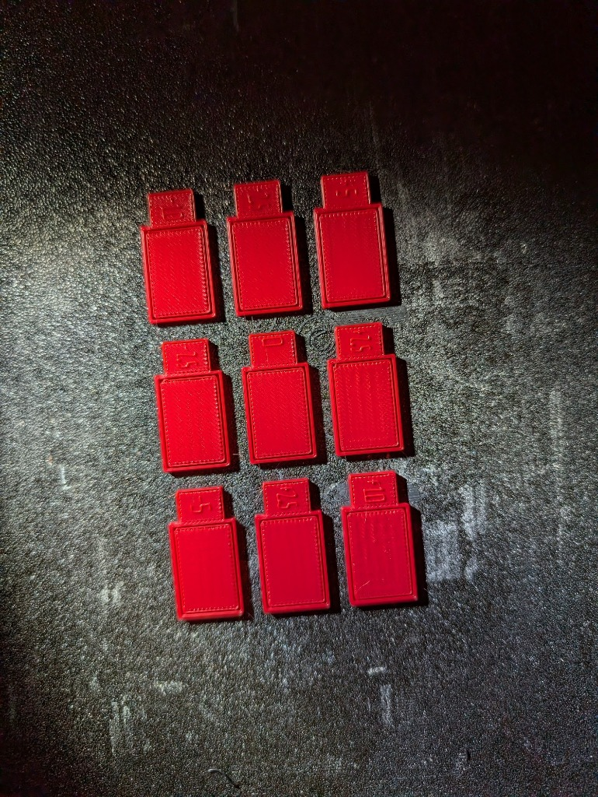
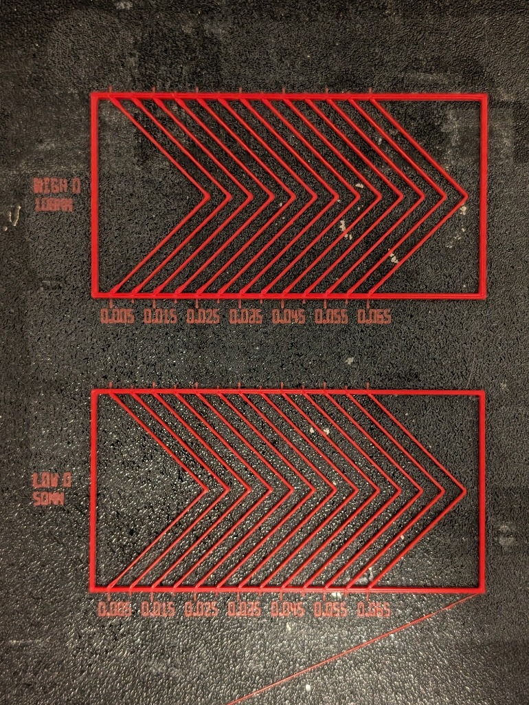
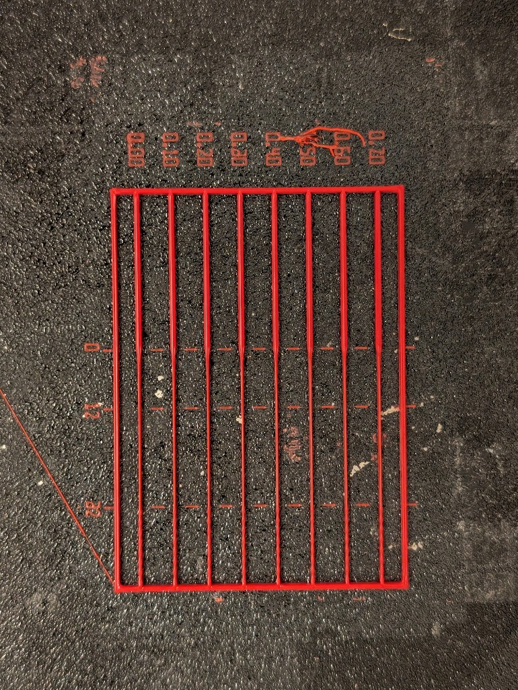
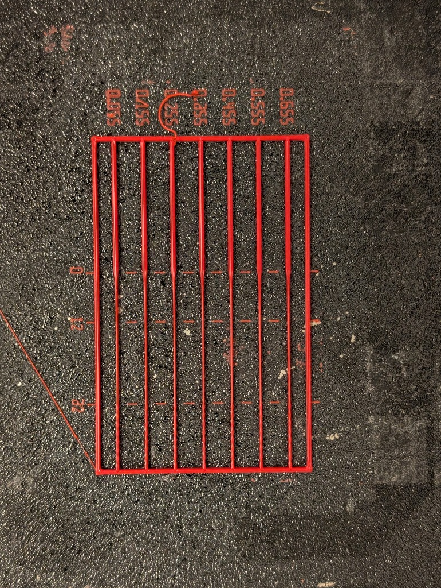

# Manifold Slicer — Polymer Rheology & Flow Calibration Guide

Because **Manifold Slicer** generates non-planar conformal layers with variable layer heights ($h \in [h_{\min}, h_{\max}]$), Arachne adaptive bead widths ($w \in [w_{\min}, w_{\max}]$), and wide volumetric flow swings between dense shells and high-speed 3D TPMS lattices, a single static extrusion multiplier and a single linear Pressure Advance value are insufficient to hold tight tolerances across an entire print.

Manifold Slicer includes a built-in **Calibration Utilities Suite** (accessible from the top menu bar via **`Calibration ▾`** in the GUI, or headlessly via `manifold-frontend calibrate` in the CLI) that generates native, kinematics-aware G-code test patterns for calibrating all four pillars of its non-Newtonian rheology model:

1. **Extrusion Multiplier (`gcode.extrusion_multiplier`)** — Pass 1 (Coarse) & Pass 2 (Fine) OrcaSlicer-style monotonic top-skin coupons.
2. **Shear-Thinning Pressure Advance (`gcode.pa_low_flow_s`, `gcode.pa_high_flow_s`)** — Ellis $90^\circ$ chevron corner pattern with dual-band volumetric flow banks (`LOW Q` and `HIGH Q`).
3. **High-Flow Viscoelastic Die Swell (`gcode.swell_high`)** — Pass 3 high-flow thick/wide top-skin coupons isolating extrudate die swell $B(Q)$ at $Q_{\text{high}}$.
4. **Transient Melt-Zone Pressure Compensation (`gcode.transient_pressure_exponent`, `gcode.transient_pressure_tau_s`)** — Constant-speed $3.4\times$ cross-section step-down rib array for Stage 1 ($\gamma$) and Stage 2 ($\tau_{\text{melt}}$).

All calibration generators automatically query the active toolhead's local orthonormal frame (`NozzleFrame`) and bed-coordinate gravity vector $\hat{\mathbf{g}}_{\text{bed}}$, so patterns can be generated and printed on 3-axis gantries, 5-axis tilting beds (`Rx`, `Ry`), and 6-axis robot arms alike.

---

## 1. Recommended Calibration Order

Because upstream volumetric parameters affect downstream dynamic pressure tests, always run the calibrations in the following order when characterizing a new filament or nozzle:

```
┌──────────────────────────────────────────────────────────────────────────┐
│ Step 1: Extrusion Multiplier (Pass 1 Coarse → Pass 2 Fine)               │
│         Sets `gcode.extrusion_multiplier` at low/moderate flow (Q_low)   │
└────────────────────────────────────┬─────────────────────────────────────┘
                                     ▼
┌──────────────────────────────────────────────────────────────────────────┐
│ Step 2: Dual-Band Shear-Thinning Pressure Advance (Ellis 90° Chevrons)   │
│         Sets `gcode.pa_low_flow_s` (at Q_low) & `gcode.pa_high_flow_s`   │
└────────────────────────────────────┬─────────────────────────────────────┘
                                     ▼
┌──────────────────────────────────────────────────────────────────────────┐
│ Step 3: High-Flow Viscoelastic Die Swell (EM Pass 3)                     │
│         Sets `gcode.swell_high` (High-Flow EM = 1 / swell_high)          │
└────────────────────────────────────┬─────────────────────────────────────┘
                                     ▼
┌──────────────────────────────────────────────────────────────────────────┐
│ Step 4: Transient Melt-Zone Pressure (Stage 1 γ → Stage 2 τ_melt)        │
│         Sets `gcode.transient_pressure_exponent` & `..._tau_s`           │
└──────────────────────────────────────────────────────────────────────────┘
```

---

## 2. Selecting the Target Toolhead (`T0`, `T1`, …)

On multi-tool machines (e.g., `T0 - 0.4mm Standard` and `T1 - 0.6mm High-Flow`), every calibration pattern is generated for a specific toolhead:

- **In the GUI (`Calibration ▾` window)**:
  - Use the **Target Tool (`T0`, `T1`, …)** selector at the top of the Calibration Utilities window to pick which extruder toolhead to calibrate.
  - You can adjust that tool's **Nozzle $\varnothing$ (`mm`)** and **Nozzle Temp (`°C`)** inline, or click **`+ Tool`** to add a new tool entry.
  - All line widths, layer heights, volumetric flow rates ($Q$), `{tool_id}` (`T0`/`T1`), `{nozzle_temp}`, and `{nozzle_diameter}` start G-code placeholders automatically use the selected tool.
- **In the CLI (`manifold-frontend calibrate`)**:
  - Pass `-t <TOOL>` / `--tool-id <TOOL>` (e.g. `-t T1`, `-t 1`, or `--tool-index 1`) to select the toolhead by `T<id>`, numeric tool ID, tool index, or name substring.

---

## 3. Extrusion Multiplier & Viscoelastic Die Swell (`em`)

### 3.1 How the Pattern Works

The Extrusion Multiplier utility generates an array of labeled rectangular test coupons arranged on the build plate:
- **Foundation & Base Layers**: Printed at $1.00\times$ nominal flow so every coupon has identical bed adhesion.
- **Upper Measurement Layers**: Printed with $100\%$ continuous serpentine **Monotonic Rectilinear** solid infill (`-45°` / `+45°` alternating per layer) using the exact stadium cross-section spacing:
  $$s = w - \left(1 - \frac{\pi}{4}\right) h$$
- **Inspection Moat Trench**: A narrow intentional trench separates the inner perimeter wall from the outer label frame so that Perimeter-to-Infill reversal ridges are confined inside the inner wall while you inspect the pure monotonic center field.
- **Printed Vector Tab Labels**: Each coupon has a top tab displaying its signed percentage modifier (e.g. `-10%`, `-5%`, `0%`, `+5%`) and its absolute flow multiplier (e.g. `0.950`, `0.975`, `1.000`, `1.025`).

### 3.2 Pass 1 (Coarse) & Pass 2 (Fine) — Baseline Extrusion Multiplier



1. **Generate & Print Pass 1 (Coarse: `-10%` to `+10%`, step `5%`)**:
   - Inspect the **center monotonic infill zone** of each coupon (ignoring the outer perimeter turnaround border) under angled light and by dragging a fingernail perpendicular to the $45^\circ$ infill lines.
2. **What to Look For**:
   - **Under-Extruded (too negative, e.g. `-10%` / `0.900`, `-5%` / `0.950`)**: Visible dark micro-gaps or pinholes between diagonal lines, or deep V-grooves between adjacent beads.
   - **Over-Extruded (too positive, e.g. `+5%` / `1.050`, `+10%` / `1.100`)**: The nozzle tip plows through excess plastic, pushing up rough, matte, catchy ridges along the diagonal lines and building up a raised lip where the infill meets the inner wall.
   - **Optimal Coupon**: The coupon whose center field is completely sealed (zero gaps between lines) while feeling **glassy-smooth** to a fingernail with no plowed ridges.
   - *Example in photo above*: `-10%` (`0.900`) and `-5%` (`0.950`) show inter-bead valleys; `+5%` (`1.050`) and `+10%` (`1.100`) show progressive over-extrusion plowing; **`0%` (`1.000`)** has the flattest, most uniform top skin.
3. **Run Pass 2 (Fine: `-2%` to `+2%`, step `1%`)**:
   - Enter the winning multiplier from Pass 1 as the Pass 2 center, generate the 5-coupon fine array, and pick the smoothest coupon to lock in `gcode.extrusion_multiplier` to within $1\%$.

### 3.3 Pass 3 — High-Flow Viscoelastic Die Swell (`swell_high`)

At high volumetric flow rates ($Q \approx Q_{\text{high}}$, default $14.0\text{ mm}^3/\text{s}$), molten polymer chains experience high shear stress in the nozzle capillary and elastically recover (expand radially) upon exiting the orifice—a phenomenon known as **viscoelastic die swell** ($B(Q) \ge 1.0$). If uncompensated, high-speed infill and thick conformal layers over-extrude and bulge outward even when low-speed walls are perfectly calibrated.

- **How Pass 3 Works**:
  - Pass 3 locks in your calibrated baseline `gcode.extrusion_multiplier` from Pass 2 and prints a 5-coupon array at high volumetric flow ($Q_{\text{high}}$, using wide beads $w = 1.45\,d_{\text{nozzle}}$ and thick layers $h = 0.62\,d_{\text{nozzle}}$), sweeping the **High-Flow Extrusion Multiplier** ($1 / B_{\text{high}}$) from `0.86` to `0.98`.
- **Reading Pass 3**:
  - Just like Pass 1/2, select the coupon whose center monotonic top surface is flattest and smoothest without plowed ridges or gaps.
  - Enter that coupon's decimal label (e.g. `0.910`) into **High-Flow Extrusion Multiplier (`1 / swell_high`)** in the GUI (or set `gcode.swell_high = 1.0 / 0.910 = 1.099` in the CLI).

---

## 4. Ellis 90° Chevron Pressure Advance Calibration (`pa`)

### 4.1 Why Dual-Band Shear-Thinning PA Matters

Molten thermoplastics are **shear-thinning (pseudoplastic)** fluids: as volumetric flow rate $Q$ increases, apparent viscosity drops and the Pressure Advance time constant $k(Q) = \Delta P / Q$ decreases following a power law between $Q_{\text{low}}$ and $Q_{\text{high}}$:

$$k(Q) = k_{\text{low}} \cdot \left(\frac{Q}{Q_{\text{low}}}\right)^{\frac{\ln(k_{\text{high}} / k_{\text{low}})}{\ln(Q_{\text{high}} / Q_{\text{low}})}}$$

Manifold Slicer's **Dual-Band Shear-Thinning PA** pattern prints two side-by-side Ellis $90^\circ$ chevron banks in a single print:
- **Bottom Bank (`LOW Q`)**: Tests $k_{\text{low}}$ (`gcode.pa_low_flow_s`) at low volumetric flow (e.g. `4.0MM3/S`, `50MM/S` for a $0.4\text{ mm}$ nozzle), matching fine outer walls and thin conformal layers.
- **Top Bank (`HIGH Q`)**: Tests $k_{\text{high}}$ (`gcode.pa_high_flow_s`) at high volumetric flow (`pa_ref_high_flow_mm3s`, default `14.0MM3/S`, `168MM/S` at $1.40\,d_{\text{nozzle}}$ width), matching fast inner walls and thick infill.
- On the left of each bank, the pattern prints three lines on Layer 0:
  1. Bank name (`LOW Q`, `HIGH Q`, or `PA`)
  2. Actual volumetric flow rate in $\text{mm}^3/\text{s}$ (e.g. `4.0MM3/S`, `14.0MM3/S`)
  3. Test cornering speed in $\text{mm/s}$ (e.g. `50MM/S`, `168MM/S`)

Each chevron is anchored into a 2-wall rectangular frame at the bottom and top and runs at full test velocity (`bank_v_fast`) all the way into and out of the $90^\circ$ rightward-pointing apex (`>`), forcing Klipper's lookahead planner to decelerate to `square_corner_velocity` right at the $90^\circ$ vertex and immediately accelerate out of it at `accel_mms2`.

### 4.2 How to Read the Ellis 90° Chevron Pattern



Inspect the **$90^\circ$ rightward-pointing vertices (`>`)** down the horizontal centerline of each bank, reading from left (`0.005`) to right (`0.065`) against the graduated bottom/top ruler ticks (major labeled ticks every $0.010\text{ s}$, minor half-ticks every $0.005\text{ s}$):

1. **PA Too Low (Left Side of Bank, e.g. `0.005` – `0.015`)**:
   - Melt-chamber pressure fails to drop as the nozzle decelerates into the corner and lags behind as it accelerates out.
   - **Visual Symptom**: The $90^\circ$ apex is **swollen, rounded, and blobby**—excess plastic bulges outward at the point of the chevron.
2. **PA Too High (Right Side of Bank, e.g. `0.045` – `0.065`)**:
   - The extruder retracts too aggressively before the corner and over-primes after it.
   - **Visual Symptom**: The bead **pinches thin, necks down, or separates completely** into a gap/hole right at the $90^\circ$ apex (or shows a bulge slightly *before* the corner followed by a starved gap at the tip).
3. **Optimal PA Value (The Sweet Spot)**:
   - Choose the chevron where the two $45^\circ$ legs maintain a **constant, uniform bead width** all the way into and out of a **crisp, sharp $90^\circ$ corner** with neither apex bulging nor post-corner thinning/gaps.
   - **Worked Example from Photo Above**:
     - **Top Bank (`HIGH Q`, `14.0MM3/S` @ `168MM/S`)**: Chevrons `0.005`–`0.015` have swollen apexes; starting around `0.035`–`0.040` the apexes begin to thin and separate (`0.055`–`0.065` have open gaps at the vertex). The sharpest, most uniform corner is between the `0.020` minor tick and `0.025` major tick $\implies$ **`gcode.pa_high_flow_s = 0.023`**.
     - **Bottom Bank (`LOW Q`, `4.0MM3/S` @ `50MM/S`)**: Because apparent viscosity is higher at lower shear rates, the corner transition shifts roughly $1.5$ chevrons to the right. Chevrons `0.005`–`0.020` are slightly rounded, while `0.045`+ thins out; the sharpest uniform corner lies right between `0.025` and `0.035` $\implies$ **`gcode.pa_low_flow_s = 0.030`**.
     - Notice that $k_{\text{low}} (0.030\text{ s}) > k_{\text{high}} (0.023\text{ s})$, directly confirming shear-thinning behavior.

---

## 5. Transient Melt-Zone Pressure Calibration (`transient`)

### 5.1 What Transient Melt-Zone Pressure Compensation Does

Standard Pressure Advance ($k \cdot dQ/dt$) compensates for instantaneous velocity changes during acceleration and deceleration, but it assumes the hotend melt zone responds instantaneously with a single time constant. When a non-planar toolpath transitions at **constant linear speed** from a high-flow feature (wide bead or thick layer) to a low-flow feature (fine wall or thin pinched layer), stored elastic energy in the melt chamber continues discharging over a relaxation timescale $\tau_{\text{melt}} \sim 0.10\text{--}0.35\text{ s}$ (`5–25 mm` of travel), causing a long over-extruded "flare" after the step-down.

Manifold Slicer models the normalized melt-chamber pressure state $P_{\text{state}}(t)$ with a first-order viscoelastic lag filter and scales extrusion flow during cross-section step-downs by:

$$m_{\text{transient}} = \left(\frac{Q_{\text{target}}}{P_{\text{state}}}\right)^{\gamma}$$

where:
- $\gamma$ (`gcode.transient_pressure_exponent`) is the **Stage 1 sensitivity exponent** controlling how strongly flow is throttled immediately after a cross-section step-down.
- $\tau_{\text{melt}}$ (`gcode.transient_pressure_tau_s`) is the **Stage 2 relaxation time constant** (in seconds) controlling the exponential decay distance over which the throttle relaxes back to $1.0\times$.

### 5.2 How the Constant-Speed Step-Down Rib Pattern Works

To prevent mechanical Z-axis motion or XY acceleration from masquerading as melt-pressure transients, the Transient Calibration pattern runs at **strictly constant layer height ($\Delta Z = 0$) and constant linear velocity ($\Delta v = 0$, default $80\text{ mm/s}$)** within each layer (`Layers 1..3`), printing vertical ribs from **Top to Bottom** across two distinct zones:

- **Zone 1 (Top $\to$ Tick `0` at center): Pre-Charge High-Flow Extrusion**
  - Extrudes a wide bead ($w_{\text{high}} = 2.80\,d_{\text{nozzle}}$, $3.4\times$ cross-sectional area) to fully saturate the hotend melt chamber at high pressure.
- **Step-Down Transition (`Tick 0`)**:
  - At the horizontal `0` fiducial tick line, the commanded bead width steps down instantaneously by $3.4\times$ to $w_{\text{low}} = 0.92\,d_{\text{nozzle}}$ with zero change in toolhead speed or nozzle height.
- **Zone 2 (`Tick 0` $\to$ `Tick 12` $\to$ `Tick 32` $\to$ Bottom Frame): Low-Flow Decay Runout**
  - Runs for $44\text{ mm}$ ($0.55\text{ s}$ at $80\text{ mm/s}$) at constant thin width $w_{\text{low}}$ so you can observe the exact shape and length of the step-down transition against the red mid-gap fiducial tick marks at `0 mm`, `12 mm`, and `32 mm`.

### 5.3 Stage 1 (Pass 1): Calibrating the Sensitivity Exponent $\gamma$ (`transient_pressure_exponent`)



Stage 1 sweeps $\gamma$ from **`0.00` (leftmost rib, compensation OFF)** to **`0.70` (rightmost rib)** in steps of `0.10`.

1. **Inspect the Transition at `Tick 0` (Top Wide Bead $\to$ Bottom Thin Bead)**:
   - **$\gamma$ Too Low (`0.00`, `0.10`, `0.20` on the left)**:
     - Stored melt-chamber pressure bleeds out unchecked after `Tick 0`, creating a **long, bulbous "baseball-bat" or teardrop flare** that stays visibly thick for $8\text{--}12\text{ mm}$ below the `0` tick before gradually tapering down to the steady-state thin line width near `Tick 12`.
   - **$\gamma$ Too High (`0.50`, `0.60`, `0.70` on the right)**:
     - The slicer throttles the extruder too aggressively immediately after `Tick 0`, causing an **hour-glass pinch (inward necking or gap)** right below `Tick 0` where the bead briefly becomes *thinner* than its steady-state width near `Tick 32`, then swells back out a few millimeters later.
   - **Optimal $\gamma$ Value**:
     - Pick the rib where the wide upper bead steps down **cleanly and crisply right at `Tick 0`** into a straight, uniform thin line whose width at `1–5 mm` below `Tick 0` already matches the steady-state width at `Tick 12` and `Tick 32`—with neither a lingering bulbous taper nor an inward hour-glass pinch.
   - **Worked Example from Photo Above**:
     - Ribs `0.00`–`0.20` show a prominent flared taper extending well below `Tick 0`.
     - Ribs `0.50`–`0.70` show visible inward necking/pinching immediately below the step-down.
     - Ribs **`0.30` and `0.40`** transition crisply at `Tick 0` into a uniform thin line $\implies$ **`gcode.transient_pressure_exponent = 0.34`** (or `0.35`).

### 5.4 Stage 2 (Pass 2): Calibrating the Relaxation Time Constant $\tau_{\text{melt}}$ (`transient_pressure_tau_s`)



Once Stage 1 ($\gamma$) is entered into your profile, Stage 2 holds $\gamma$ fixed and sweeps the relaxation time constant $\tau_{\text{melt}}$ across 7 ribs from **`0.05S` (leftmost rib)** to **`0.65S` (rightmost rib)** in steps of `0.10 s`.

1. **Inspect the Zone between `Tick 0`, `Tick 12`, and `Tick 32`**:
   - **$\tau_{\text{melt}}$ Too Short (e.g. `0.05S` on the far left)**:
     - At $80\text{ mm/s}$, $\tau = 0.05\text{ s}$ corresponds to a decay length of only $v \cdot \tau = 4\text{ mm}$. The flow throttle releases before the physical melt chamber has finished depressurizing, leaving a **secondary residual bulge between `3 mm` and `10 mm` below `Tick 0`** (just above `Tick 12`).
   - **$\tau_{\text{melt}}$ Too Long (e.g. `0.35S` – `0.65S` on the right)**:
     - At $80\text{ mm/s}$, $\tau = 0.45\text{ s} \implies 36\text{ mm}$ decay length. The slicer keeps throttling flow long after the real nozzle pressure has already equalized, starving the bead so the line between **`Tick 0` and `Tick 12` (and even down toward `Tick 32`) is visibly thinner and starved** compared to the recovered line near the bottom frame.
   - **Optimal $\tau_{\text{melt}}$ Value**:
     - Pick the rib where the thin bead maintains a **dead-constant width from `1 mm` below `Tick 0`, past `Tick 12`, and all the way past `Tick 32`**.
   - **Worked Example from Photo Above**:
     - Rib `0.05S` still has a slight lingering taper above `Tick 12`.
     - Ribs `0.35S`–`0.65S` look progressively thinner/starved throughout the `0`–`12` mm zone because the throttle persists too long.
     - Ribs **`0.15S`** (and the lower side of `0.25S`) maintain the most uniform line width across `0`, `12`, and `32` $\implies$ **`gcode.transient_pressure_tau_s = 0.15`** (representing a physical melt-chamber relaxation distance of $v \cdot \tau \approx 12\text{ mm}$ at $80\text{ mm/s}$).

---

## 6. Generating Calibration Patterns from the GUI & CLI

### 6.1 Interactive GUI Workflow

1. Click **`Calibration ▾`** in the top menu bar to open the **Polymer Rheology & Flow Calibration Utilities** window.
2. Select the **Target Tool (`T0`, `T1`, …)** at the top of the window (and verify its nozzle diameter and temperature).
3. Switch to the desired tab (**`1. Extrusion Multiplier`**, **`2. Pressure Advance (Ellis)`**, or **`3. Transient Melt Pressure`**) and configure the pass/mode parameters.
4. Click:
   - **`Preview in 3D Viewport`** to load the generated calibration toolpaths directly into the interactive 3D viewport (allowing you to scrub layers, inspect feedrates/widths, and click **`Export G-code`** in the main toolbar), or
   - **`Export Calibration G-code…`** to save the `.gcode` file directly to disk.
5. After inspecting the print, enter your measured value into the **Apply Calibrated Value to Profile** box at the bottom of the tab (and save your **Filament Preset** in the top presets bar so it persists for future prints).

### 6.2 Headless CLI Workflow (`manifold-frontend calibrate`)

You can generate any calibration pattern headlessly from the terminal using `manifold-frontend calibrate` (combining your printer/tool/filament/process presets, `-p profile.json`, `-t <TOOL>`, and `-s key=value` overrides):

```bash
# 1. Extrusion Multiplier — Pass 1 (Coarse: -10% to +10% around current EM) for Tool T0:
manifold-frontend calibrate em \
  -p my_profile.json -t T0 --pass 1 \
  -o calib_em_pass1.gcode

# 2. Extrusion Multiplier — Pass 2 (Fine: -2% to +2% around 1.00):
manifold-frontend calibrate em \
  -p my_profile.json -t T0 --pass 2 --center 1.00 \
  -o calib_em_pass2.gcode

# 3. Extrusion Multiplier — Pass 3 (High-Flow Viscoelastic Die Swell at Q_high):
manifold-frontend calibrate em \
  -p my_profile.json -t T0 --pass 3 \
  -s gcode.extrusion_multiplier=1.00 \
  -o calib_em_pass3_swell.gcode

# 4. Ellis 90° Chevron Pressure Advance — Dual-Band Shear-Thinning (LOW Q + HIGH Q):
manifold-frontend calibrate pa \
  -p my_profile.json -t T0 --mode dual \
  --start 0.005 --end 0.065 --step 0.005 \
  -o calib_pa_dual.gcode

# 5. Transient Melt-Zone Pressure — Stage 1 (Exponent γ sweep 0.00 .. 0.70):
manifold-frontend calibrate transient \
  -p my_profile.json -t T0 --pass 1 \
  --start 0.00 --end 0.70 --step 0.10 \
  -o calib_transient_stage1_gamma.gcode

# 6. Transient Melt-Zone Pressure — Stage 2 (Relaxation τ_melt sweep 0.05s .. 0.65s):
manifold-frontend calibrate transient \
  -p my_profile.json -t T0 --pass 2 \
  -s gcode.transient_pressure_exponent=0.34 \
  --start 0.05 --end 0.65 --step 0.10 \
  -o calib_transient_stage2_tau.gcode
```

Once you have read the optimal values from your prints, save them directly into your profile or filament preset via `manifold-frontend profile set`:

```bash
manifold-frontend profile set my_profile.json \
  gcode.extrusion_multiplier=1.00 \
  gcode.pa_low_flow_s=0.030 \
  gcode.pa_high_flow_s=0.023 \
  gcode.swell_high=1.10 \
  gcode.transient_pressure_exponent=0.34 \
  gcode.transient_pressure_tau_s=0.15
```
